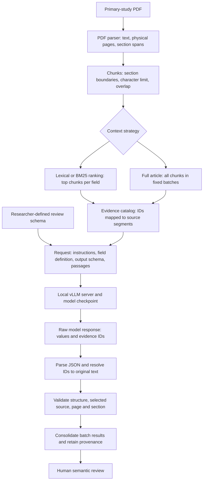

# Pipeline walkthrough for the adviser meeting

This guide describes the implementation used in the P1 pilot. Code paths are relative to the repository root. Read alongside [the pilot results](p1-meeting-results.md).

## 1. The flow in one picture



There are three different units: a **chunk** is a document/context unit; an **evidence segment** is an addressable passage inside a chunk; a **batch** groups chunks for one request. One field × one batch = one model call. The latest pilot uses 26 chunks, one per batch, and seven fields: 182 calls per model for a complete run. Only three fields were run for Llama (78 calls).

## 2. What each component does

| Component | Input → output | Responsibility and limitation |
| --- | --- | --- |
| `config/gender_and_beyond_schema.json` | Research decisions → seven field descriptions | Researchers define `name`, `definition`, `retrieval_terms`. These terms rank chunks in retrieval mode and can optionally be included in the prompt. |
| `definitions/schema_definition.py` | Schema JSON → validated Pydantic objects | Checks required properties, types, nonempty text and unique field names. Does not establish scientific validity of the definitions. |
| `parsing/pdf_parser.py` | PDF → article JSON | Uses pypdf; records physical one-based pages, extracted text, warnings, source hash and heuristic section spans. No LLM. PDF extraction can leave broken words/table order and imperfect headings. |
| `chunking/chunking_creation.py` | Page text/spans → chunks | Cleans whitespace, respects detected section boundaries, preserves page offsets. Current config: max 2,500 characters, overlap 250 within a section. Characters are not tokens. No silent first-pages-only truncation. |
| `chunking/chunk_selection.py` | Chunks + terms → ranked chunks | Lexical baseline and experimental BM25. Used by ordinary `prepare`; not used to filter final full-article batches. It is not an LLM. |
| `chunking/evidence_segments.py` | Selected chunks → segment catalog | Heuristic punctuation/page splitting, segments at most 400 characters, stable IDs, source offsets. Model returns IDs; resolver copies quote/page/section/chunk metadata from the catalog. |
| `chunking/batching.py` | Ordered chunks → groups | Groups using estimated message characters across fields. Frozen plans can be reused. Exact model-token budget is checked separately. |
| `definitions/result_definition.py` | JSON fields/values/evidence → output objects | Defines the universal final output contract, including value, quotes and locations. A different intermediate contract, `SelectedField`, lives in `evidence_segments.py`. |
| `pipeline.py` | Schema/config + context → requests and validated results | Builds prompts, calls the model client, resolves responses and invokes validation. Orchestrates modules rather than performing PDF parsing itself. |
| `validation/evidence_validation.py` | Result + selected chunks/pages → accepted result/error | Checks field identity, source quote/page range and parser-backed section. It cannot determine whether a citation logically supports a value. |
| `validation/preflight.py` | Requests + local server → compatibility/token checks | Ordinary CLI preflight. Batch experiments use `scripts/check_batch_tokens.py`, including chat-template arguments. |
| `execution/audit.py` | Each attempted call → files | Raw response, validated output where available, status, error and elapsed time. |
| `execution/cli.py` | CLI PDF/JSON arguments → prepared or executed run | Entry point for the standard pipeline, including PDF parsing and source snapshots. |
| `execution/ollama_cli.py` | Local pilot inputs → Ollama run | Earlier Mac pilot adapter. Not the current PCAD execution path. |
| `scripts/serve_pilot.py` | Model config → running vLLM process | Pins model/tokenizer revisions, sets context/dtype/seed, records server command, environment and GPU. Does not extract study data. |
| `scripts/prepare_full_article.py` | Saved article/config/schema + plan → requests | Current experimental preparation. Retains all chunks. Optional `--schema`/`--config` explicitly replace snapshots; otherwise saved versions are used. No generation. |
| `scripts/check_batch_tokens.py` | Prepared requests → token approval | Calls `/tokenize`, checks input + reserved output against context limit, records request hashes. No generation. |
| `scripts/run_batch_field.py` | Approved requests → one field across batches | Current execution path. No automatic retry; resume only pending calls. Consolidates exact value/evidence duplicates, not semantic synonyms. |

`run_diagnostic.py` and `run_minimal_impacts.py` are experimental helpers. The latter deliberately selects two known P1 passages and must not be treated as a normal end-to-end extraction result. `compare_selection.py` supports the lexical/BM25 experiment.

## 3. Where the model is actually called

In `scripts/run_batch_field.py`, the client is created as:

```python
with OpenAI(base_url=base, api_key='EMPTY', max_retries=0, timeout=300) as client:
    pipeline.client = client
```

`OpenAI` is the **Python client library**, not the model provider in this experiment. `base` is `http://127.0.0.1:8000/v1`, so it sends HTTP requests to vLLM on the allocated compute node. `EMPTY` is a placeholder for this local endpoint. No OpenAI commercial inference API is used.

The actual generation request is inside `ExtractionPipeline.extract()` in `pipeline.py`:

```python
raw = self.client.chat.completions.with_raw_response.create(**item['request'])
record.raw(raw.text)
response = raw.parse()
```

`with_raw_response` lets us save the original API response before parsing. The response envelope contains `choices`; the generated JSON text is in `choices[0].message.content`. An outer valid API JSON response does not mean the model content is valid JSON.

The request assembled by `_request()` contains:

- `model`: the served checkpoint ID;
- a system message with generic extraction instructions;
- a user message with field definition, intermediate output JSON Schema, and passages/IDs;
- temperature, seed, output-token limit and other generation parameters.

The base pipeline builds `response_format`, but **the batch preparation and batch runner remove it**. Thus these comparison runs use unconstrained generation: the JSON Schema is shown as prompt text, but the decoder is not forced to follow it. This is why Llama can return Markdown and explanations. Ordinary CLI behavior is different; do not describe every run as constrained decoding.

## 4. What the LLM returns versus what the pipeline produces

Illustrative intermediate model output (not a measurement):

```json
{
  "field_name": "reported_impacts",
  "status": "extracted",
  "values": [{
    "value": "Potential discriminatory outcomes",
    "evidence_ids": ["chunk-0002-e006"]
  }],
  "notes": null
}
```

`resolve_selection()` looks up the ID in the catalog supplied for that call. It builds final evidence with `quote`, `page_start`, `page_end`, `section` and `chunk_id`. The model does not generate those final location properties in evidence-ID mode.

The lookup prevents altered quotes and rejects unknown IDs. However, a model can select a real but irrelevant ID: the final quote is authentic while the claim remains unsupported. This is the key distinction between **source traceability** and **semantic validity**.

For the full-article runner, a failed batch makes the consolidated field incomplete. `consolidated-review.json` preserves partial results and errors; `field-result.json` is written only when all batches for the field succeeded. A successful empty field means no values were returned, not proof that none exist in the paper.

## 5. The model checkpoints used

| Checkpoint | Pilot role | Important distinction |
| --- | --- | --- |
| `Qwen/Qwen2.5-7B-Instruct` | Initial PCAD experiments | 7B instruction-tuned model; earlier BF16 setup. Not the Qwen used in the latest matched comparison. |
| `Qwen/Qwen3-14B-AWQ` | Main recent baseline | 14B model, AWQ weights; thinking disabled through the Qwen chat-template option. Revision `31c69efc29464b6bb0aee1398b5a7b50a99340c3`. |
| `hugging-quants/Meta-Llama-3.1-8B-Instruct-AWQ-INT4` | Three-field comparison | 8B instruction-tuned model, community AWQ INT4 checkpoint. Revision `db1f81ad4b8c7e39777509fac66c652eb0a52f91`. |

“B” refers to billions of parameters. Instruct means tuned to respond to instructions. AWQ/INT4 refers to weight quantization; `dtype=bfloat16` in the serving configuration does not undo that quantization and make all weights BF16. Smaller stored weights make local serving more practical, but quantization is part of the checkpoint being evaluated.

The Llama template does not implement Qwen's `enable_thinking` switch; the request argument remains present for request consistency. Model-native tokenizers and templates differ, so identical textual messages do not imply identical token sequences. Pin and record these artifacts.

Current comparison settings: vLLM 0.11.0, RTX 4090 24 GB, context limit 8,192 tokens, output limit 2,048, temperature 0, seed 42, top_p 1, one concurrent sequence, no retries. Temperature zero is greedy-style decoding, not a guarantee of bit-for-bit reproducibility across different hardware/software executions.

There is no training or fine-tuning in this pipeline. We perform inference using downloaded checkpoints. Model size alone does not predict extraction quality. A model can obey JSON syntax while misunderstanding a field, or find useful information but violate the output contract.

## 6. Recommended reading order in the IDE

1. `config/gender_and_beyond_schema.json`: what we ask the model to extract.
2. `definitions/result_definition.py`: final result shape.
3. `chunking/evidence_segments.py`: how IDs become traceable quotes.
4. `pipeline.py`: system instructions → `_request()` → `extract()`.
5. `scripts/run_batch_field.py`: where the local client is connected and calls are repeated.
6. `parsing/pdf_parser.py` and `chunking/chunking_creation.py`: how the context was produced.
7. One saved `batch-02/request.json`, `field-01.raw.txt`, `field-01.status.json`, and `field-01.validated.json` if present.

## 7. What is still provisional

The final evaluation protocol, semantic matching rules and complete human references are not implemented/approved. P1 has been used repeatedly for development. The unit of extraction still varies in model output: independent concepts may be grouped, repeated or mixed with other fields. Section detection and PDF tables are heuristic. These limitations should be discussed before scaling to all ten studies.
